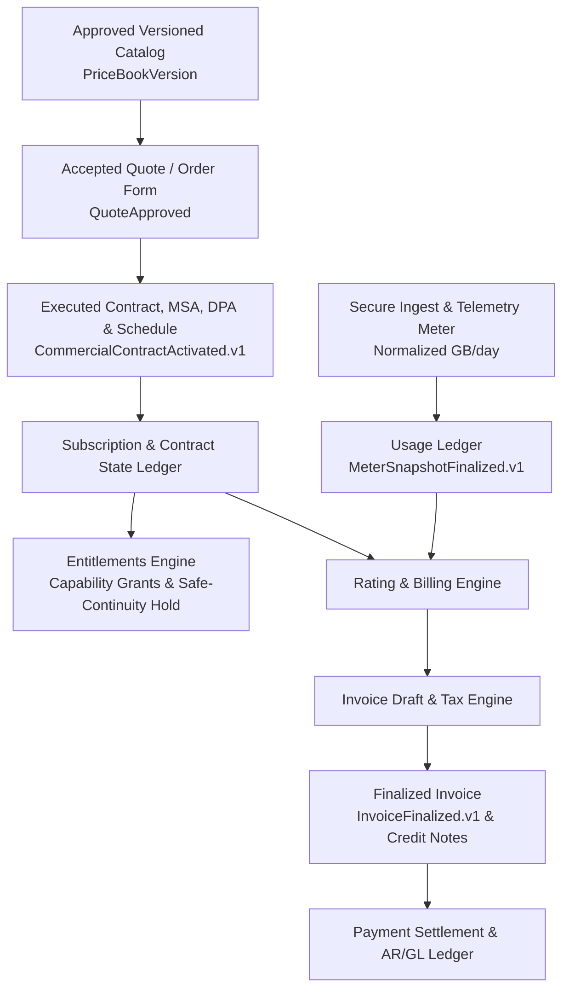

# ADR-08 (ACCEPTED) — Commercial Authority Consolidation & Target Ownership Model

**Status: ACCEPTED**  
**Document Control:** `ZS-COM-MASTER-002 v2.0 §16, §22 (WP1)`  
**Supersedes / Unifies:** Historical single-domain Commercial notes in `ZS-COM-BILL-001`, `ADR-06`, and `ADR-07`.

---

## 1. Context & Problem Statement

Prior audits of `zoiko-shield-platform` identified overlapping modules across `shield-core` (`commercial`, `commerce`, `billing`, `cpq`, `sla`, `tax`, `dunning`, `entitlements`, and `metering`). Under `ZS-COM-MASTER-002 v2.0 Section 16`, operational authority for every commercial ledger, pricing calculation, grant mutation, and invoice must be assigned to **exactly one authoritative service**.

No service may infer or derive pricing, contracts, or entitlements from client-side state, unapproved price books, or raw security telemetry.

---

## 2. Authoritative Target Ownership Matrix (v2.0 §16)

| Domain Owner (Target) | Authoritative Responsibility (Single Source of Truth) | Read-Only Consumers |
| :--- | :--- | :--- |
| **Catalog / Pricing Authority** | `ProductFamily`, `SKUVersion`, `PriceBookVersion`, market activation, pricing approvals (`D01/P0`). | Frontend `/pricing`, CPQ, Sales, Billing |
| **CPQ / Deal Authority** | `Quote`, discounts, exception approvals, maker-checker signoff, proposal acceptance. | Sales, Finance, Contract Generator |
| **Commerce / Contract Authority** | Executed contracts (`ContractVersion`), signed amendments, subscription timelines, term bounds. | Entitlements, Billing, Customer Portal |
| **Entitlement Authority** | Resolved capability grants, quantity caps, tenant safe-continuity exceptions (`C01`). | API Gateway, Domain Guards, Customer UI |
| **Metering Authority** | Canonical daily usage, deduplication keys, raw vs. normalized basis, burst policy, exclusion proofs. | Billing Rating, CFO Cost Model |
| **Billing Authority** | Draft/final invoices, tax nexus snapshot, currency minor units, credits, debit notes, AR posting. | Customer Finance Portal, AR System |
| **Collections / Dunning** | Customer notices, delinquency state machine (`DUE` → `CLOSED`), commercial restriction proposals. | Billing, Customer Success, Security Operations |
| **Service Operations** | MDR / IR coverage hours, fulfilled obligations, runbook authorization, SLA evaluator. | Customer Portal, SLA Evaluator |
| **Audit / Evidence** | Immutable approvals, Merkle root receipts, event hashes, export packages (`ZS-ENG-EV-001`). | Legal, Security, Independent Auditor |

---

## 3. Commercial Authority Hierarchy & Invariant Flow (v2.0 §07)

### Mandatory Non-Negotiable Rules:
1. **Downstream Replicas Are Not Authoritative:** Frontend displays, demo sliders, and external payment processors (e.g. Stripe webhooks) are downstream replicas. They are **never** authoritative for contractual grants or entitlements.
2. **Two-Plane Separation (Plane A vs. Plane B):** Customer operational security telemetry, incident cases, and evidence stores (Plane B) are strictly isolated from the commercial ledger (Plane A). Raw case contents and personal data are never exposed to finance or billing systems.
3. **Safe-Continuity Survives Commercial Enforcement:** Delinquency escalates contract commercial status only. It cannot suspend critical security visibility, evidence access, incident containment, or legal hold (`C01`, `P0-09`, `P0-10`).
4. **Idempotent Outbox Events:** All cross-domain commercial state changes are published via a transactional outbox (`CommercialContractActivated.v1`, `MeterSnapshotFinalized.v1`, `InvoiceFinalized.v1`, `SafeContinuityGranted.v1`) with deduplication keys ensuring exactly-once business effects.

---

## 4. Consequences & Decision Gates

- **WP1 Exit Evidence:** Met by the formal adoption of this ADR and alignment with the database schema lineage in `commercial.prisma`, `cpq.prisma`, `metering.prisma`, and `dunning.prisma`.
- **Gate D03 Status:** **CLOSED / RESOLVED** by assigning single-writer responsibility per this specification.
